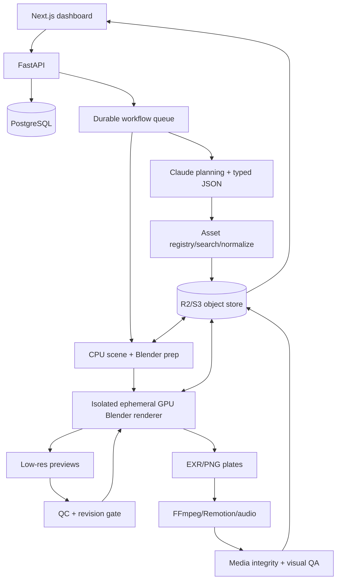

# System architecture and sequencing

## Boundary contracts

- **Frontend:** authentication, brief input, live server job state, shot list/storyboard, video previews, manual approvals, budgets, library browser.
- **API:** Pydantic request/response schemas, project ownership, persisted state, signed object URLs, rate limits, user-level quotas.
- **Director:** produces strictly validated storyboard/shot JSON; no arbitrary code execution.
- **Asset service:** metadata, source provenance, thumbnails, checksums, license guards, derivatives. Storage identifiers immutable.
- **World engine:** typed scene operations: place/import/create/assign/shade/animate; deterministic seeds; geometry and scale validation.
- **Camera/Lighting:** independent programmable native Blender rigs; each receives explicit shot camera/light specs.
- **Render:** CPU preview, GPU final, frame chunks, asset preflight, immutable job manifests; artifact hashes; no rendering from network URLs without verified download.
- **Editorial:** timeline tracks, frames, narration, SFX, captions, compositing, FFmpeg validation.
- **QC:** mechanical + sampled-visual review with bounded repair cycle and human gate for ambiguous failures.

## Recommended technology

Next.js + TypeScript; FastAPI + Pydantic; PostgreSQL; durable workflow engine (pick Temporal or BullMQ, don't duplicate orchestration); Anthropic API; Blender 4.5 LTS baseline unless compatibility validation chooses newer; R2/S3; RunPod GPUs; FFmpeg + Remotion. Container API separately from network-restricted Blender worker. Record component versions and vendor docs links.

## Fundamental invariants

A shot has one versioned spec and deterministic seed. A render always refers to exact version, frame range, assets and container image. Job replays are idempotent. An edited camera must invalidate that shot's plates, but not unrelated sound/assets. Every price estimate labels its assumptions. Never call a smoke test a production-quality render.
